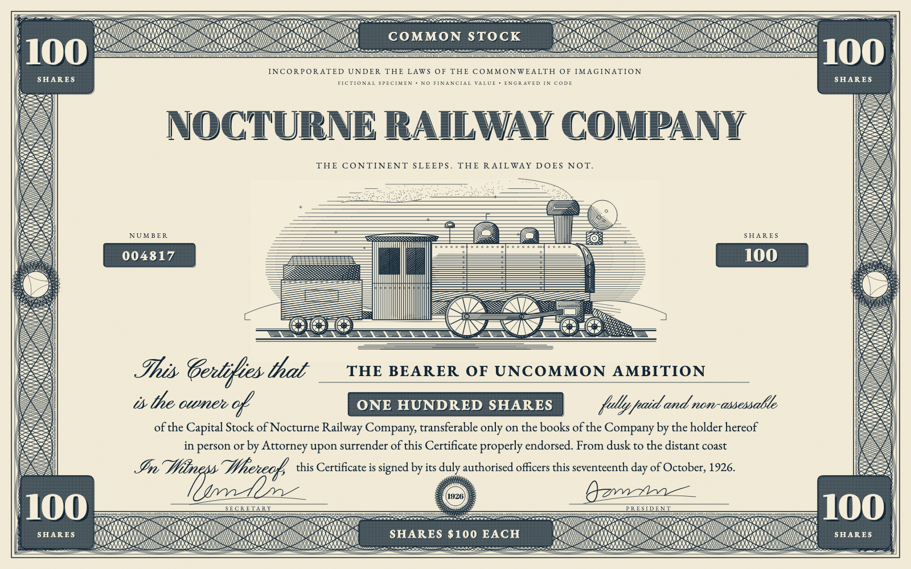

# Copperplate

Create fictional engraved stock certificates from a one-line company description.

```sh
npx skills add qvotvm/copperplate
```

Select your agent in the installer, or install directly:

```sh
npx skills add qvotvm/copperplate --agent claude-code --global
npx skills add qvotvm/copperplate --agent codex --global
npx skills add qvotvm/copperplate --agent hermes-agent --global
```



In Claude Code, ask `/copperplate a 1920s railroad that only runs at night`.
In Codex, ask `$copperplate a 1920s railroad that only runs at night`.
In Hermes, ask `Use the copperplate skill to draw a certificate for a 1920s railroad that only runs at night`.

The agent writes the company specification and drawing. The kit produces engine-turned borders, shaded lettering and a hatched vignette in one or two inks. Outputs are standalone HTML and SVG, with local PNG and silent MP4 exports. Every certificate is marked as a specimen. The skill creates fictional artwork, not real securities.

Node.js 22+ is required. Install Chrome or Chromium for audits and PNG exports, and ffmpeg for MP4. There are no npm dependencies or API keys. Fonts are bundled. Set `CHROME_PATH` or `FFMPEG_PATH` if executable discovery needs an override.

From the installed skill folder or a local checkout:

```sh
node scripts/build.mjs examples/night-railway/spec.json out/railway
node scripts/audit.mjs out/railway.html --out out/railway.audit.json
node scripts/render.mjs out/railway.html out/railway.png --scale 2
node scripts/render.mjs out/railway.html out/railway.mp4 --duration 15
```

To rebuild and verify all seven source examples:

```sh
node --test scripts/geometry.test.mjs
node scripts/build-examples.mjs
node scripts/verify.mjs
```

Read the [skill instructions](SKILL.md), [kit API](references/kit.md), [vignette vocabulary](references/vignettes.md) and [engraving study](references/engraving-study/README.md). Generated examples and videos are not stored in the repository.

Code and drawings are [MIT](LICENSE). Bundled fonts retain their [SIL Open Font License](assets/fonts/OFL.txt).
